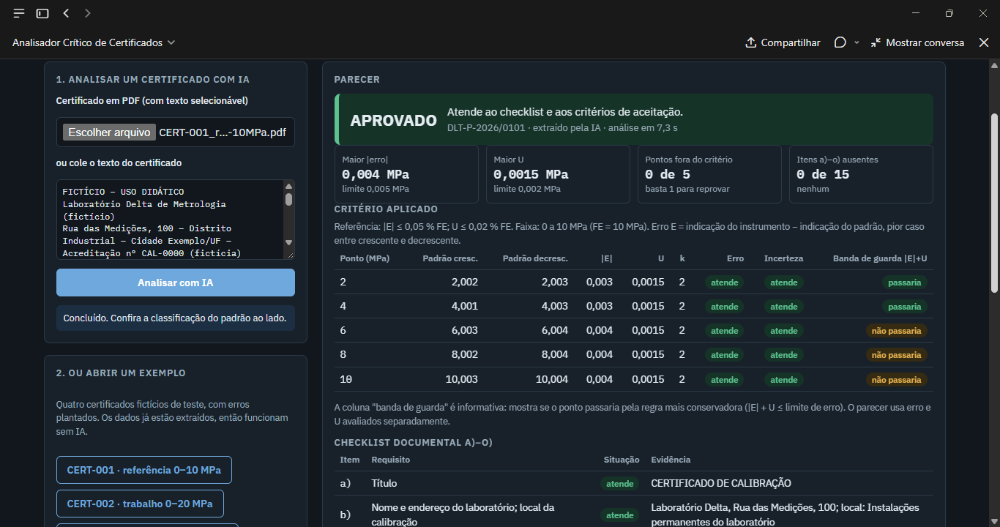
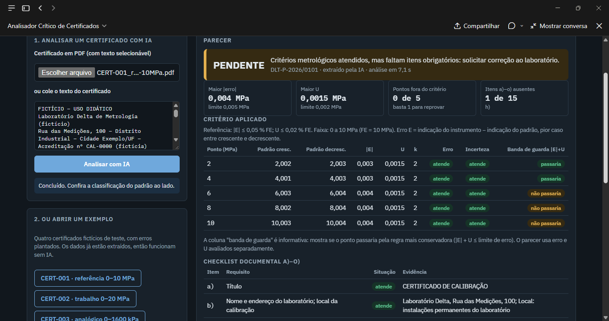
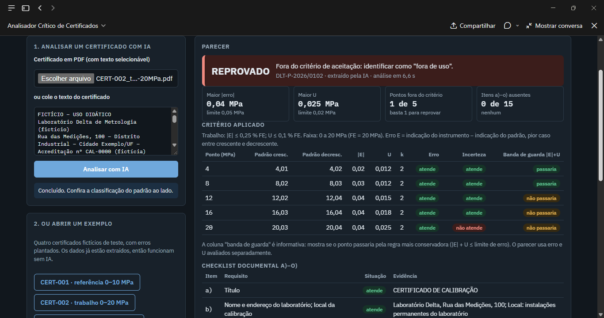
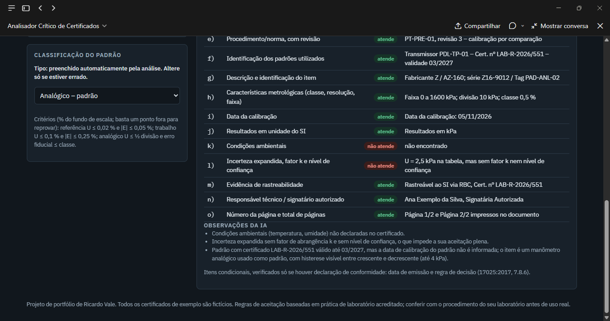
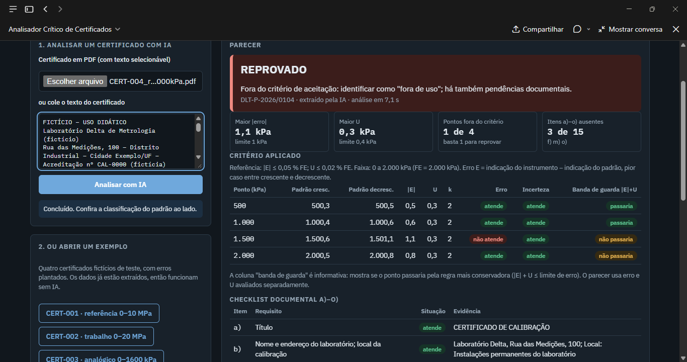

# Analisador Crítico de Certificados de Calibração – Pressão

Ferramenta que faz a **análise crítica do certificado de um padrão de pressão** assim que ele volta da calibração externa, antes de o padrão voltar ao uso.
**A IA lê o certificado; a página faz as contas.** A decisão final é do signatário autorizado.

> **Status:** protótipo validado com 4 certificados fictícios em 13/11/2026. Ainda não é usado em produção.
> Todos os certificados deste repositório são fictícios (marcados "FICTÍCIO – USO DIDÁTICO").


<!-- VÍDEO: link do vídeo de demonstração (fluxo completo com IA) -->

---

## Problema

Quando um padrão de pressão volta da calibração externa, o laboratório precisa conferir o certificado antes de usá-lo:

- se o documento traz os itens obrigatórios (laboratório, rastreabilidade, incerteza com fator k, condições ambientais etc.);
- se o erro e a incerteza de **cada ponto** estão dentro do critério de aceitação do padrão.

Feita à mão, essa conferência leva **~60 min por certificado** (estimativa de especialista) e é repetitiva: são dezenas de valores lidos, calculados e comparados um a um.

Além do tempo, há risco de **aprovação indevida**: com dezenas de valores e atividades paralelas, um ponto fora do critério pode passar despercebido.

## Solução

Uma página web que recebe o certificado em PDF e devolve um parecer em três níveis:

| Parecer | Quando | Ação |
|---|---|---|
| **APROVADO** | Checklist completo e todos os pontos dentro do critério | Padrão liberado para uso |
| **PENDENTE** | Critérios metrológicos atendidos, mas falta item documental | Solicitar correção ao laboratório |
| **REPROVADO** | Pelo menos um ponto fora do critério | Identificar o padrão como "fora de uso" |

Junto com o parecer, a página mostra o **cálculo ponto a ponto, com unidades**, o checklist documental a)–o) com a evidência de cada item e as observações da IA.

## Como funciona

```
PDF do certificado
      │
      ▼
┌────────────────────────────────┐
│ IA                             │  lê o texto, extrai os dados
│ (extração + checklist)         │  e confere os itens a)–o)
└────────────────────────────────┘
      │  dados estruturados
      ▼
┌────────────────────────────────┐
│ Página (código determinístico) │  calcula |E| e compara E e U
│ (cálculo + regra de decisão)   │  com os limites, ponto a ponto
└────────────────────────────────┘
      │
      ▼
Parecer + cálculo visível  →  signatário confere e decide
```

**Por que a IA não faz os cálculos?** IA é boa para ler documentos com layouts variados; o cálculo de aceitação precisa ser reproduzível e auditável. Cada parte faz o que faz melhor, e a conta fica visível para conferência.

### Checklist documental (núcleo)

| Item | Requisito | Item | Requisito |
|---|---|---|---|
| a) | Título | i) | Data da calibração |
| b) | Laboratório, endereço e local da calibração | j) | Resultados em unidade do SI |
| c) | Nº do certificado em cada página e indicação de fim | k) | Condições ambientais |
| d) | Cliente e endereço | l) | U com fator k **e** nível de confiança |
| e) | Procedimento/norma com revisão | m) | Rastreabilidade (padrão e certificado identificados) |
| f) | Padrões utilizados | n) | Responsável técnico / signatário |
| g) | Descrição e identificação do item | o) | Página X de Y |
| h) | Faixa **e** resolução (classe só para analógico) | | |

Itens condicionais, verificados só quando o certificado declara conformidade: data de emissão e regra de decisão (ABNT NBR ISO/IEC 17025:2017, 7.8.6 – item citado de memória; conferir no exemplar da norma).

### Critérios de aceitação (% do fundo de escala)

| Tipo de padrão | Incerteza (U) | Erro |
|---|---|---|
| Digital de referência | U ≤ 0,02 % | \|E\| ≤ 0,05 % |
| Digital de trabalho | U ≤ 0,1 % | \|E\| ≤ 0,25 % |
| Analógico | U ≤ ½ divisão | erro fiducial = maior \|E\| ÷ faixa × 100 ≤ classe |

- **E = indicação do instrumento − indicação do padrão**, pior caso entre crescente e decrescente.
- **Um ponto fora reprova.** Erro e U são avaliados separadamente.
- A banda de guarda (|E| + U) aparece só como informação, não entra no parecer.
- A correção pela curva não entra no parecer: vai para o orçamento de incerteza das calibrações feitas com o padrão.
- Os critérios vêm da prática de um laboratório acreditado; cada laboratório deve configurar os do seu procedimento.

**Exemplo (CERT-002, padrão digital de trabalho, 0 a 20 MPa, ponto de 20 MPa):**

| Grandeza | Limite | Valor no certificado | Resultado |
|---|---|---|---|
| \|E\| | 0,25 % × 20 MPa = 0,05 MPa | 0,04 MPa | atende |
| U (k = 2) | 0,1 % × 20 MPa = 0,02 MPa | 0,025 MPa | **não atende** |

Um ponto fora → **REPROVADO**.

## Como testar

**Ferramenta:** https://claude.ai/artifact/EHDjdLnvDGzpPvsVujJkfF

1. **Sem IA (qualquer pessoa):** na seção "2. Ou abrir um exemplo", clique em um dos 4 certificados. Os dados já estão extraídos e o parecer aparece na hora.
2. **Com IA (exige conta no Claude):** na seção "1. Analisar um certificado com IA", envie um dos PDFs da pasta `certificados/` e clique em "Analisar com IA".

| Exemplo | Tipo e faixa | Erro plantado | Parecer esperado |
|---|---|---|---|
| CERT-001 | Digital de referência, 0–10 MPa | Nenhum | APROVADO |
| CERT-002 | Digital de trabalho, 0–20 MPa | U = 0,025 MPa > 0,02 MPa em 1 ponto | REPROVADO |
| CERT-003 | Analógico, 0–1600 kPa | Faltam k) e l) | PENDENTE |
| CERT-004 | Digital de referência, 0–2000 kPa | \|E\| = 1,1 kPa > 1,0 kPa; faltam f), m), o) | REPROVADO |

O gabarito completo está em `testes/gabarito.csv`.

## Resultados

Teste com os 4 certificados fictícios e gabarito, em 13/11/2026.

| Certificado | Esperado | Rodada 1 | Rodada 2 (após correção) |
|---|---|---|---|
| CERT-001 | APROVADO | PENDENTE (falso positivo em h) | **APROVADO** |
| CERT-002 | REPROVADO | REPROVADO (+ falso positivo em h) | **REPROVADO** |
| CERT-003 | PENDENTE | PENDENTE | – (não afetado) |
| CERT-004 | REPROVADO | REPROVADO | – (não afetado) |

**CERT-001, rodada 1:** PENDENTE por falso positivo no item h). Na rodada 2, após a correção, saiu APROVADO (tela no início deste README).



**CERT-002, rodada 2:** REPROVADO; U = 0,025 MPa no ponto de 20 MPa, acima do limite de 0,02 MPa.



**CERT-003:** checklist com k) e l) ausentes e as observações da IA.



**CERT-004:** REPROVADO; |E| = 1,1 kPa no ponto de 1500 kPa, acima do limite de 1 kPa, e itens f), m) e o) ausentes.



| Métrica | Valor | Origem |
|---|---|---|
| Erros plantados detectados | 7 de 7 | Medido (teste com gabarito, 13/11/2026) |
| Pareceres corretos | 4 de 4 (após 1 correção) | Medido (teste com gabarito, 13/11/2026) |
| Tempo da IA | 6 a 7 s por certificado | Medido (13/11/2026) |
| Conferência humana do parecer | ~1 min por certificado | Medido (13/11/2026) |
| Análise manual de referência | ~60 min por certificado | **Estimativa de especialista** (não medido) |

**O que a rodada 1 ensinou**

- **Causa do falso positivo:** a instrução do item h) cobrava classe de exatidão também de instrumento digital. Foi corrigida para exigir faixa e resolução, com classe só para analógico. Depois da correção, o teste foi repetido e comparado com o gabarito.
- **Ajuste no dado de teste:** o CERT-002 imprimia U com 2 casas (0,03 em vez de 0,025). Corrigido para 3 casas.
- **Ganho não previsto:** no CERT-003, a IA apontou sozinha a histerese de até 4 kPa e a falta da data de calibração do padrão.

## Como foi construído com IA

Construído em 1 dia com o Claude, sem escrever código à mão:

1. **Critérios:** defini o checklist a)–o) e os limites de aceitação a partir da minha prática como signatário autorizado.
2. **Dados de teste:** pedi ao Claude certificados fictícios com erros plantados e um gabarito, para medir os acertos de forma objetiva.
3. **Ferramenta:** a página foi gerada pelo Claude e usa a IA dentro dela para ler o PDF; os cálculos ficam em código determinístico.
4. **Teste e correção:** rodei os 4 certificados, comparei com o gabarito, encontrei um falso positivo, corrigi a instrução da IA e repeti o teste.
5. **Organização:** Projeto no Claude com instruções, arquivos de teste e diário de bordo, para qualquer nova conversa continuar do mesmo ponto.

## Limitações

- **Amostra pequena e fictícia:** 4 casos de teste provam o método, não o uso em produção.
- **Tempos:** os ~60 min são estimativa de especialista; o ~1 min e os 6 a 7 s foram medidos.
- **PDF com texto:** certificado digitalizado (imagem) ainda não é lido.
- **Acesso:** a análise com IA pelo link exige conta no Claude; os exemplos funcionam sem IA.
- **Decisão humana:** a ferramenta prepara o parecer; quem decide e assina é o signatário autorizado.
- **Critérios configuráveis:** vêm do procedimento de um laboratório; outro laboratório deve usar os seus.
- **Norma:** os itens da ABNT NBR ISO/IEC 17025:2017 foram citados de memória; conferir no exemplar da norma.

**Para uso em produção falta:** validação como software (17025:2017, 7.11.2 – citado de memória), amostra real anonimizada comparada com o parecer do signatário (meta: zero falso negativo), variedade de formatos (psi, bar, MPa; layouts diferentes), leitura de PDF digitalizado, controle de versão das regras e autorização para enviar certificados a um serviço de IA externo.

## Próximas versões

- **Histórico do padrão (v2):** comparar a calibração atual com a anterior pelo erro normalizado, ponto a ponto, com critério |Eₙ| ≤ 1:

  Eₙ = (x_atual − x_anterior) / √(U_atual² + U_anterior²)

- **Deriva e curva de regressão**, hoje feitas em planilha separada (critério de aceitação da deriva ainda em aberto).
- **Leitura de PDF digitalizado** (OCR ou IA com visão).
- **Outras grandezas:** temperatura e massa.
- **Automação:** certificado chega por e-mail, é analisado e o resultado vai para a planilha de controle.

## Estrutura do repositório

```
analisador-certificados-calibracao/
├── README.md
├── analisador_pagina.html          # página: interface, cálculo e regra de decisão
├── gerar_certificados_ficticios.py # gera os 4 PDFs de teste com erros plantados
├── certificados/                   # certificados fictícios de teste
│   ├── CERT-001_ref_0-10MPa.pdf
│   ├── CERT-002_trab_0-20MPa.pdf
│   ├── CERT-003_analog_0-1600kPa.pdf
│   └── CERT-004_ref_0-2000kPa.pdf
├── testes/
│   └── gabarito.csv                # parecer e erros esperados por certificado
└── docs/
    └── img/                        # prints usados neste README
```

## Autor

**Ricardo Vale de Farias** – Técnico em Metrologia com mais de 20 anos em calibração e qualidade laboratorial (ABNT NBR ISO/IEC 17025), especialidade Pressão. Atuou como Signatário Autorizado, elaborando procedimentos e emitindo e analisando criticamente certificados. Concluindo Engenharia de Software.

[LinkedIn: linkedin.com/in/ricardovale-metrologia](https://www.linkedin.com/in/ricardovale-metrologia)

Projeto desenvolvido com apoio do Claude (IA) para a programação. O domínio técnico, os critérios e a validação dos resultados são do autor.
